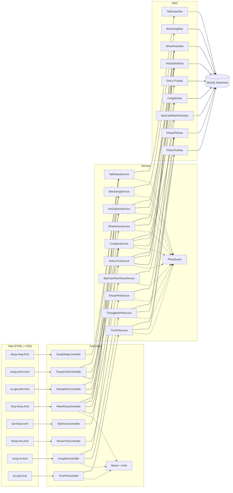
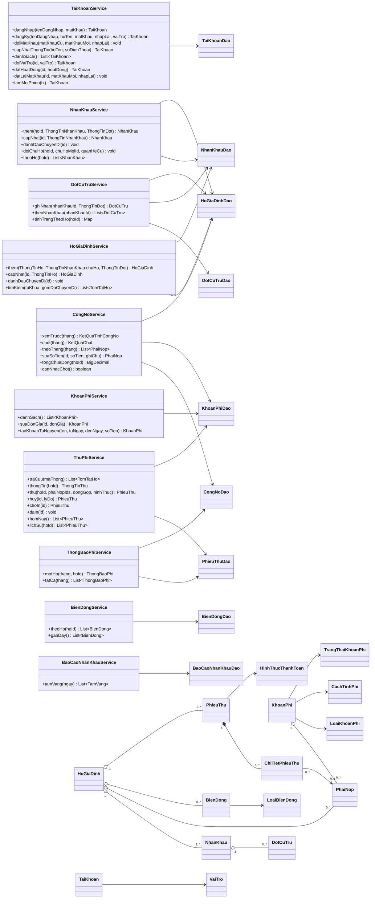

# Sơ đồ lớp

Mô tả các lớp trong `src/main/java/com/bluemoon` sau Sprint 3. Kiến trúc
phân tầng và bảng chức năng ↔ mã nguồn xem [architecture.md](architecture.md).

## Phân tầng và phụ thuộc

DAO hộ gia đình, nhân khẩu, đợt tạm trú/tạm vắng ghi `bien_dong_nhan_khau`
trong cùng giao dịch (qua `BienDongDaoImpl.ghi`), nên `BienDongDao` chỉ có
hàm đọc.

## Lớp nghiệp vụ chính

Mọi hàm của Service nhận `TaiKhoan nguoi` (người đang đăng nhập) làm tham số
đầu và kiểm tra quyền bằng `PhanQuyen.yeuCau`; sơ đồ lược bỏ tham số này.
Ngoại lệ: `dangNhap`, `lamMoiPhien`, `thangHienTai` (xem
[architecture.md](architecture.md#phân-quyền)).

Mỗi `XxxDao` là interface, có `XxxDaoImpl` cài bằng JDBC; test dùng DAO giả
trong bộ nhớ (`KhoGia`, `KhoThuPhiGia`, `KhoPhieuThuGia`); phần cần MySQL thật
(khóa dòng, deadlock, giao dịch) có thêm các lớp `*IT` ([testing.md](../testing.md)).

## Ghi chú thiết kế

- Service nhận DAO qua constructor nên test dùng DAO giả trong bộ nhớ, không
  cần MySQL (xem `src/test/java/com/bluemoon/service`).
- `ThongTinHo`, `ThongTinNhanKhau`, `ThongTinDot` là dữ liệu nhập từ form,
  tách khỏi model để Service kiểm tra hợp lệ trước khi tạo model.
- `KiemTraNhanKhau` gom các quy tắc kiểm tra nhân khẩu dùng chung; `LoiTrung`
  đổi lỗi trùng khóa của CSDL (khi hai máy cùng lưu) thành thông báo nghiệp
  vụ; `SoTien` đọc và hiển thị số tiền kiểu Việt Nam.
- `PhanQuyen` kiểm tra vai trò ở Service (lớp thứ hai sau việc ẩn menu).
- Lớp tiện ích của tầng Controller (không phải màn hình): `HopThoai` (nút
  hộp thoại tiếng Việt: "Đồng ý", "Hủy", "Đóng", và cặp nút chính + "Đóng"
  cho hộp thoại hủy phiếu), `LoiCsdl` (phân biệt mất kết nối với lỗi dữ liệu
  để chọn thông báo), `LoiKhongMongDoi` (bộ xử lý lỗi toàn cục, `App` gọi
  khi khởi động, hiện hộp thoại thay vì chỉ in console),
  `TomTatPhieuHomNay` (số phiếu, tiền đã thu, số phiếu hủy của dải tóm tắt
  tab Phiếu thu hôm nay).
- `NghiepVuException`: lỗi nghiệp vụ hiển thị cho người dùng;
  `DaoException` (và lớp con `TrungKhoaException`): lỗi truy cập CSDL;
  `CauHinhException`: lỗi đọc `config/db.properties`.
- `PhienLamViec` giữ tài khoản đang đăng nhập; `DieuHuong` chuyển màn hình;
  `BangLichSu` dựng bảng lịch sử biến động dùng chung cho hai màn hình.
- `MauIn` dựng trang in (biên lai, thông báo phí, danh sách tạm vắng);
  `InAn` xem trước rồi in bằng `PrinterJob`, dùng chung cho ba chức năng.
- `XungDotException` (con của `DaoException`): DAO kiểm tra lại dưới khóa
  dòng và phát hiện dữ liệu vừa đổi ở máy khác (khoản vừa được thu, số tiền
  vừa sửa, hết số biên lai); Service đổi thành thông báo nghiệp vụ.
- `DangBiKhoaException` (con của `DaoException`): MySQL huỷ giao dịch vì
  deadlock (1213) hoặc chờ khóa quá hạn (1205); Service hiện "Có người khác
  đang thao tác trên hộ này, vui lòng thử lại".
- `DongHoCsdl` (extends `Clock`): giờ máy chủ MySQL (`SELECT NOW()`), dùng
  cho `ThuPhiService`, `CongNoService` khi chạy thật; test dùng
  `Clock.fixed` (giả định 38).
- `ThongTinThu` (record lồng trong `ThuPhiService`): hộ, khoản chưa đóng và
  các quỹ đang mở kèm tình trạng đóng góp của hộ (`DongGopQuy`).
