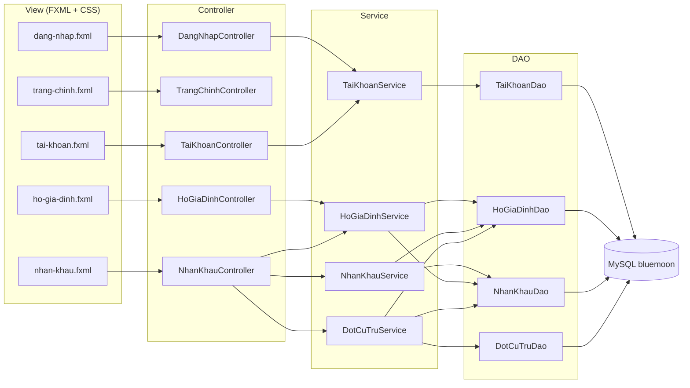
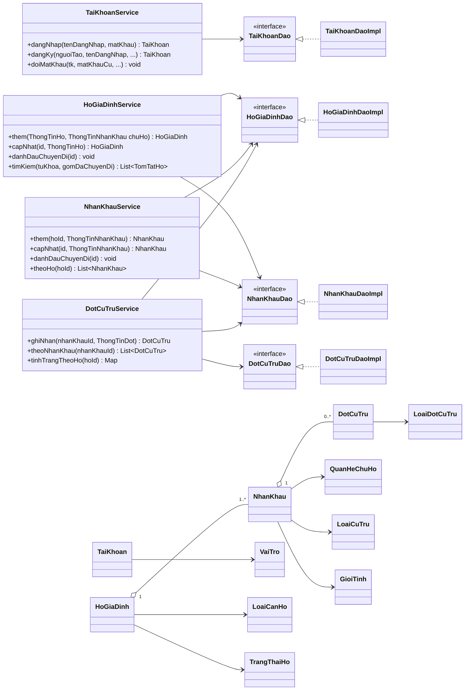

# Sơ đồ lớp

Mô tả các lớp đã có trong `src/main/java/com/bluemoon` sau Sprint 1. Kiến
trúc phân tầng xem [architecture.md](architecture.md).

## Phân tầng và phụ thuộc

## Lớp nghiệp vụ chính

## Ghi chú thiết kế

- Service nhận DAO qua constructor nên test dùng DAO giả trong bộ nhớ, không
  cần MySQL (xem `src/test/java/com/bluemoon/service`).
- `ThongTinHo`, `ThongTinNhanKhau`, `ThongTinDot` là dữ liệu nhập từ form,
  tách khỏi model để Service kiểm tra hợp lệ trước khi tạo model.
- `KiemTraNhanKhau` gom các quy tắc kiểm tra nhân khẩu dùng chung cho
  `HoGiaDinhService`, `NhanKhauService` và `DotCuTruService`; `LoiTrung` đổi
  lỗi trùng khóa của CSDL (khi hai máy cùng lưu) thành thông báo nghiệp vụ.
- `NghiepVuException`: lỗi nghiệp vụ hiển thị cho người dùng;
  `DaoException` (và lớp con `TrungKhoaException`): lỗi truy cập CSDL;
  `CauHinhException`: lỗi đọc `config/db.properties`.
- `PhienLamViec` giữ tài khoản đang đăng nhập; `DieuHuong` chuyển màn hình.
