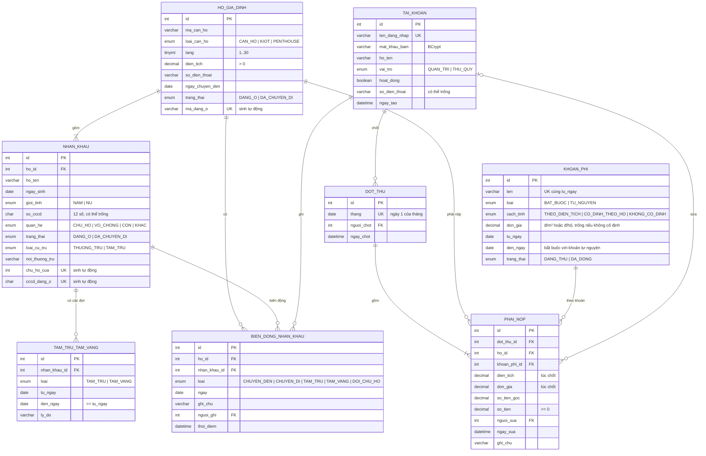

# Thiết kế cơ sở dữ liệu (ERD)

Nguồn sự thật: [`database/schema.sql`](../../database/schema.sql). Khi
sửa schema phải cập nhật file này trong cùng Pull Request.

## Sơ đồ thực thể – liên kết (Sprint 1 và Sprint 2)

`PHAI_NOP` có `UNIQUE (dot_thu_id, ho_id, khoan_phi_id)`: mỗi hộ có một
dòng cho mỗi khoản bắt buộc trong một tháng.

## Ràng buộc nghiệp vụ được đảm bảo ở tầng CSDL

| Quy tắc | Cách thực hiện | Story |
|---|---|---|
| Không có hai hộ **đang ở** cùng mã căn hộ; hộ đã chuyển đi vẫn giữ lịch sử | Cột sinh `ma_dang_o` = mã căn hộ khi `DANG_O`, NULL khi đã chuyển đi, kèm `UNIQUE` | US-001 |
| Mỗi hộ chỉ có một chủ hộ | Cột sinh `chu_ho_cua` = `ho_id` khi `quan_he = CHU_HO`, kèm `UNIQUE` | US-002 |
| Không trùng CCCD giữa những người đang ở | Cột sinh `cccd_dang_o`, kèm `UNIQUE` | US-002 |
| Ngày kết thúc tạm trú/tạm vắng không trước ngày bắt đầu | `CHECK (den_ngay >= tu_ngay)` | US-003 |
| Diện tích dương, tầng 1–30 | `CHECK` trên `ho_gia_dinh` | US-001 |
| Mỗi tháng một đợt chốt; chốt lại không tạo trùng khoản của hộ | `UNIQUE (thang)` trên `dot_thu`, `UNIQUE (dot_thu_id, ho_id, khoan_phi_id)` trên `phai_nop` | AC-028 |
| Tên khoản thu không trùng trong cùng đợt | `UNIQUE (ten, tu_ngay)` trên `khoan_phi` | AC-020 |
| Khoản tự nguyện được để trống số tiền; khoản bắt buộc luôn tính theo diện tích | `CHECK` trên `cach_tinh`, `don_gia` | AC-021, US-005 |
| Số tiền phải nộp không âm | `CHECK (so_tien >= 0)` | US-008 |
| Không xóa cứng dữ liệu nghiệp vụ | Đổi `trang_thai` thay vì `DELETE` | NFR truy vết |
| Lịch sử biến động không lệch với dữ liệu | Ghi `bien_dong_nhan_khau` trong cùng giao dịch với thêm hộ, thêm nhân khẩu, chuyển đi, ghi tạm trú/tạm vắng; lỗi thì hoàn tác cả hai | US-027 (AC-076 – AC-078) |

Quy tắc cần đọc dữ liệu nhiều dòng (CCCD bắt buộc từ 14 tuổi, các đợt tạm
trú không chồng nhau) kiểm tra ở tầng Service; đợt tạm trú/tạm vắng khóa
dòng bằng `SELECT ... FOR UPDATE` để hai máy không ghi chồng.

## Chốt công nợ (US-009) và sửa khoản thu (US-008)

Chốt tháng chạy trong một giao dịch: lấy (hoặc tạo) dòng `dot_thu` của
tháng, rồi thêm `phai_nop` cho mọi hộ `DANG_O` × mọi khoản `BAT_BUOC` đang
thu mà **chưa có dòng**, với `so_tien = so_tien_goc = ROUND(dien_tich ×
don_gia)`. Lỗi giữa chừng thì hoàn tác cả lần chốt.

Chốt lại cùng tháng không tạo trùng (AC-028) nhưng bổ sung được hộ chuyển
đến hoặc khoản bắt buộc mới sau lần chốt đầu; dòng đã có, kể cả đã sửa,
giữ nguyên. `UNIQUE (dot_thu_id, ho_id, khoan_phi_id)` chặn trùng kể cả
khi hai máy chốt cùng lúc. Khoản tự nguyện không tạo công nợ; tiền đóng
góp ghi khi thu (Sprint 3).

Diện tích và đơn giá được chép vào `phai_nop` lúc chốt, nên đổi đơn giá
sau đó không làm thay đổi tháng đã chốt. Sửa khoản của một hộ (US-008)
chỉ đổi `so_tien` và ghi `nguoi_sua`, `ngay_sua`, `ghi_chu`; `so_tien_goc`
giữ số hệ thống tính. Từ Sprint 3, Service từ chối sửa khi khoản đã có
phiếu thu (AC-026).

`ho_gia_dinh.dien_tich` là `NOT NULL` và `> 0`, nên trường hợp "hộ chưa
có diện tích" của AC-029 không xảy ra với dữ liệu nhập qua ứng dụng.
Service vẫn kiểm tra để bỏ qua và cảnh báo nếu gặp.

## Lịch sử biến động nhân khẩu (US-027)

Mỗi dòng ghi một nhân khẩu chuyển đến, chuyển đi, đăng ký tạm trú hoặc tạm
vắng: ngày biến động (ngày chuyển đến của hộ, ngày bắt đầu đợt, hoặc ngày
thao tác), người ghi và thời điểm ghi. Đánh dấu cả hộ chuyển đi ghi một dòng
cho mỗi thành viên còn đang ở. Bảng chỉ thêm, không sửa, không xóa; loại
`DOI_CHU_HO` để sẵn cho US-026. Dữ liệu dùng cho màn hình lịch sử của hộ,
danh sách biến động gần đây ở Trang chính và báo cáo cho công an (US-004).

Lỗi trùng khóa (MySQL 1062) được `TrungKhoaException` đổi thành thông báo
nghiệp vụ theo tên ràng buộc.

## Bảng dự kiến ở các Sprint sau

Theo `schema.sql` và Product Backlog; thiết kế chi tiết bổ sung khi bắt
đầu Sprint tương ứng:

| Sprint | Bảng | Phục vụ |
|---|---|---|
| Sprint 3 | `phieu_thu`, `phieu_thu_chi_tiet` | US-007, US-010 đến US-014 (thu phí, đóng góp, biên lai, hủy phiếu) |

Hướng thiết kế Sprint 3 (đã chốt, giả định 21–25):

- `phieu_thu`: mã biên lai tăng liên tục, hộ, tổng tiền, hình thức thanh
  toán, người thu, thời điểm, trạng thái hủy, người hủy, lý do hủy. Hủy
  không xóa phiếu (AC-043).
- `phieu_thu_chi_tiet`: mỗi dòng một khoản trong phiếu; trỏ tới `phai_nop`
  với khoản bắt buộc (đóng đủ số tiền), hoặc tới `khoan_phi` với đóng góp
  tự nguyện (số tiền bất kỳ, kể cả 0 đ). Một phiếu thu nhiều khoản (US-011).
- Khoản phải nộp "đã đóng" khi có dòng chi tiết thuộc phiếu chưa hủy; hủy
  phiếu thì khoản tự trở lại chưa đóng (AC-041).
- Lập phiếu khóa các dòng `phai_nop` được chọn bằng `SELECT ... FOR UPDATE`
  để hai máy không thu trùng một khoản.
