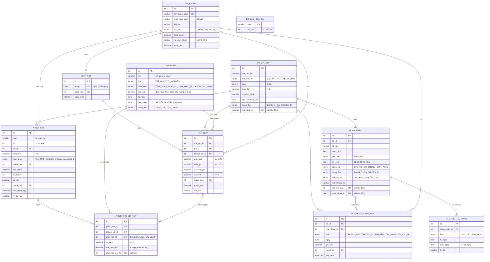

# Thiết kế cơ sở dữ liệu (ERD)

Nguồn sự thật: [`database/schema.sql`](../../database/schema.sql). Khi
sửa schema phải cập nhật file này trong cùng Pull Request.

## Sơ đồ thực thể – liên kết (Sprint 1 – Sprint 3)

`BO_DEM_BIEN_LAI` không nối khóa ngoại với bảng nào: đây là bộ đếm số
biên lai của từng năm.

`PHAI_NOP` có `UNIQUE (dot_thu_id, ho_id, khoan_phi_id)`: mỗi hộ có một
dòng cho mỗi khoản bắt buộc trong một tháng.

## Ràng buộc nghiệp vụ được đảm bảo ở tầng CSDL

| Quy tắc | Cách thực hiện | Story |
|---|---|---|
| Không có hai hộ **đang ở** cùng mã căn hộ; hộ đã chuyển đi vẫn giữ lịch sử | Cột sinh `ma_dang_o` = mã căn hộ khi `DANG_O`, NULL khi đã chuyển đi, kèm `UNIQUE` | US-001 |
| Mỗi hộ chỉ có một chủ hộ | Cột sinh `chu_ho_cua` = `ho_id` khi `quan_he = CHU_HO`, kèm `UNIQUE` | US-002 |
| Không trùng CCCD giữa những người đang ở | Cột sinh `cccd_dang_o`, kèm `UNIQUE` | US-002 |
| Ngày kết thúc tạm trú/tạm vắng không trước ngày bắt đầu | `CHECK (den_ngay >= tu_ngay)` | US-003 |
| Diện tích dương, tầng 1–30 | `CHECK` trên `ho_gia_dinh` | US-001 |
| Mỗi tháng một đợt chốt; chốt lại không tạo trùng khoản của hộ | `UNIQUE (thang)` trên `dot_thu`, `UNIQUE (dot_thu_id, ho_id, khoan_phi_id)` trên `phai_nop` | AC-028 |
| Tên khoản thu không trùng trong cùng đợt | `UNIQUE (ten, tu_ngay)` trên `khoan_phi` | AC-020 |
| Khoản tự nguyện được để trống số tiền; khoản bắt buộc luôn tính theo diện tích | `CHECK` trên `cach_tinh`, `don_gia` | AC-021, US-005 |
| Số tiền phải nộp không âm | `CHECK (so_tien >= 0)` | US-008 |
| Một khoản phải nộp chỉ thuộc một phiếu còn hiệu lực | Cột sinh `phai_nop_da_thu` = `phai_nop_id` khi `con_hieu_luc`, kèm `UNIQUE` | AC-033, AC-041 |
| Số biên lai không trùng, năm khớp ngày lập | `UNIQUE (nam, so)`, `CHECK (nam = YEAR(thoi_diem))` trên `phieu_thu` | Giả định 31 |
| Phiếu có tiền phải có hình thức thanh toán | `CHECK (tong_tien = 0 OR hinh_thuc IS NOT NULL)` | AC-038, giả định 30 |
| Phiếu hủy phải đủ người hủy, thời điểm, lý do | `CHECK` trên bốn cột hủy | AC-043, giả định 28 |
| Không xóa cứng dữ liệu nghiệp vụ | Đổi `trang_thai` (hộ, nhân khẩu) hoặc `da_huy` (phiếu thu) thay vì `DELETE` | NFR truy vết |
| Lịch sử biến động không lệch với dữ liệu | Ghi `bien_dong_nhan_khau` trong cùng giao dịch với thêm hộ, thêm nhân khẩu, chuyển đi, ghi tạm trú/tạm vắng; lỗi thì hoàn tác cả hai | US-027 (AC-076 – AC-078) |

Quy tắc cần đọc dữ liệu nhiều dòng (CCCD bắt buộc từ 14 tuổi, các đợt tạm
trú không chồng nhau) kiểm tra ở tầng Service; đợt tạm trú/tạm vắng khóa
dòng bằng `SELECT ... FOR UPDATE` để hai máy không ghi chồng.

## Chốt công nợ (US-009) và sửa khoản thu (US-008)

Chốt tháng chạy trong một giao dịch: lấy (hoặc tạo) dòng `dot_thu` của
tháng, rồi thêm `phai_nop` cho mọi hộ `DANG_O` × mọi khoản `BAT_BUOC` đang
thu mà **chưa có dòng**, với `so_tien = so_tien_goc = ROUND(dien_tich ×
don_gia)`. Lỗi giữa chừng thì hoàn tác cả lần chốt.

Chốt lại cùng tháng không tạo trùng (AC-028) nhưng bổ sung được hộ chuyển
đến hoặc khoản bắt buộc mới sau lần chốt đầu; dòng đã có, kể cả đã sửa,
giữ nguyên. `UNIQUE (dot_thu_id, ho_id, khoan_phi_id)` chặn trùng kể cả
khi hai máy chốt cùng lúc. Khoản tự nguyện không tạo công nợ; tiền đóng
góp ghi khi thu (Sprint 3).

Diện tích và đơn giá được chép vào `phai_nop` lúc chốt, nên đổi đơn giá
sau đó không làm thay đổi tháng đã chốt. Sửa khoản của một hộ (US-008)
chỉ đổi `so_tien` và ghi `nguoi_sua`, `ngay_sua`, `ghi_chu`; `so_tien_goc`
giữ số hệ thống tính. Khoản đã có phiếu thu còn hiệu lực thì không sửa
được (AC-026): điều kiện "chưa thu" nằm ngay trong câu `UPDATE … WHERE
NOT EXISTS (…)`, nên khoản vừa được thu ở máy khác cũng không bị sửa.

`ho_gia_dinh.dien_tich` là `NOT NULL` và `> 0`, nên trường hợp "hộ chưa
có diện tích" của AC-029 không xảy ra với dữ liệu nhập qua ứng dụng.
Service vẫn kiểm tra để bỏ qua và cảnh báo nếu gặp.

## Lịch sử biến động nhân khẩu (US-027)

Mỗi dòng ghi một nhân khẩu chuyển đến, chuyển đi, đăng ký tạm trú hoặc tạm
vắng: ngày biến động (ngày chuyển đến của hộ, ngày bắt đầu đợt, hoặc ngày
thao tác), người ghi và thời điểm ghi. Đánh dấu cả hộ chuyển đi ghi một dòng
cho mỗi thành viên còn đang ở. Bảng chỉ thêm, không sửa, không xóa; loại
`DOI_CHU_HO` để sẵn cho US-026. Dữ liệu dùng cho màn hình lịch sử của hộ,
danh sách biến động gần đây ở Trang chính và báo cáo cho công an (US-004).

Lỗi trùng khóa (MySQL 1062) được `TrungKhoaException` đổi thành thông báo
nghiệp vụ theo tên ràng buộc.

## Phiếu thu (US-007, US-010 – US-014)

Thiết kế theo giả định 21–32 trong
[`11-chot-va-gia-dinh.md`](../requirements/11-chot-va-gia-dinh.md).

- **Một phiếu, nhiều khoản (US-011).** Mỗi dòng `phieu_thu_chi_tiet` hoặc
  thu một khoản phải nộp (`phai_nop_id`, đóng đủ số tiền hiện tại, giả định
  23), hoặc ghi một lần đóng góp tự nguyện (`phai_nop_id` trống, số bất kỳ).
  `khoan_phi_id` luôn có để thống kê theo khoản (Sprint 4) không phải nối
  qua `phai_nop`.
- **"Đã đóng"** nghĩa là có dòng chi tiết thuộc phiếu chưa hủy. Khoản phải
  nộp 0 đ (đã sửa về 0) không tính là nợ và không cần thu.
- **Đóng góp tự nguyện (giả định 29).** Một hộ đóng được nhiều lần cho một
  quỹ; tổng là cộng các lần trên phiếu chưa hủy. Ghi 0 đ nghĩa là "không
  đóng" (AC-023), chỉ ghi được khi hộ chưa có lần nào cho quỹ đó.
- **Số biên lai (giả định 31).** `PT-<năm>-<5 chữ số>`, đánh lại mỗi năm.
  Trong giao dịch lập phiếu: tạo dòng của năm nếu chưa có, khóa bằng
  `SELECT so_cuoi … FOR UPDATE`, tăng một. Giao dịch hoàn tác thì số cũng
  hoàn tác, nên dãy số liên tục; phiếu hủy giữ số của nó.
- **Lập phiếu** chạy trong một giao dịch, khóa theo thứ tự cố định để không
  tạo vòng chờ: dòng `ho_gia_dinh` → các dòng `phai_nop` được chọn (kiểm tra
  lại chưa thu và số tiền không đổi) → bộ đếm của năm. Hai máy thu cùng một
  khoản thì chỉ một phiếu thành công; máy kia được báo tra cứu lại
  (`PhieuThuIT`).
- **Hủy phiếu (US-014, giả định 28)** trong một giao dịch: đặt `da_huy`,
  người hủy, thời điểm, lý do và đặt `con_hieu_luc = FALSE` cho các dòng, để
  khoản phải nộp trở lại chưa đóng (AC-041). Quyền và điều kiện "trong ngày"
  (AC-042) kiểm tra ở Service, theo cùng đồng hồ với lúc lập phiếu.
- **In biên lai (US-013).** `so_lan_in` tăng sau mỗi lần in; từ lần thứ hai
  biên lai ghi "BẢN IN LẠI" (AC-040). Phiếu 0 đ và phiếu đã hủy không in.

## Bảng dự kiến ở các Sprint sau

| Sprint | Bảng | Phục vụ |
|---|---|---|
| Sprint 4 | `nhat_ky` | Nhật ký thao tác (NFR truy vết), thống kê US-016 – US-019 đọc từ `phieu_thu` |
