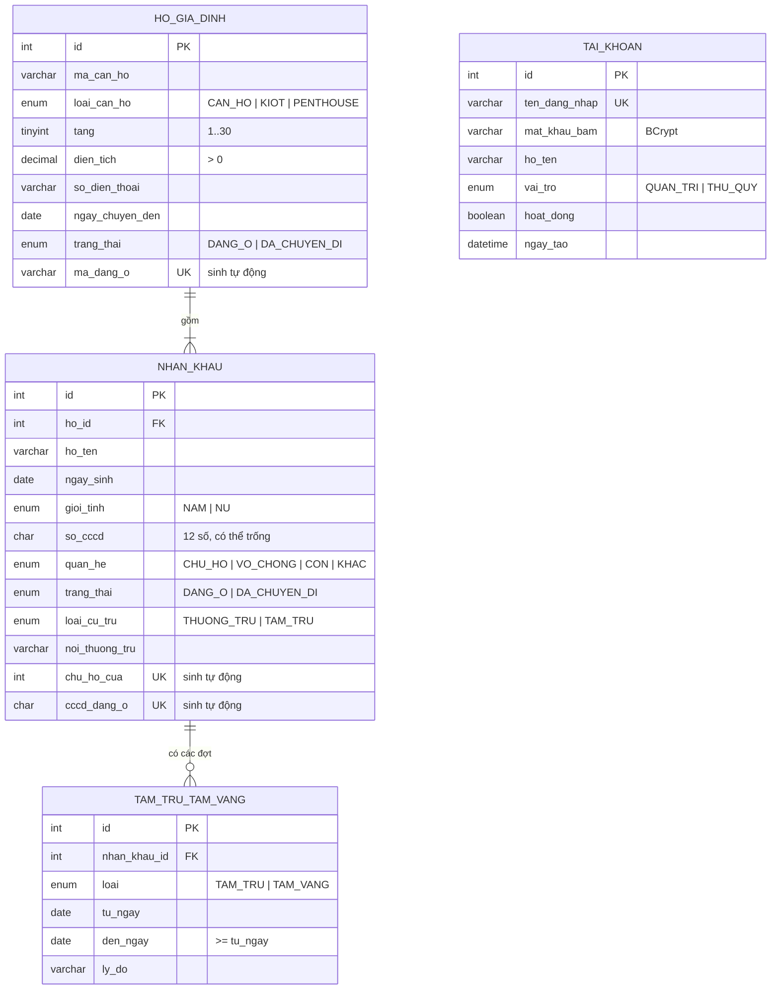

# Thiết kế cơ sở dữ liệu (ERD)

Nguồn sự thật: [`database/schema.sql`](../../database/schema.sql). Khi
sửa schema phải cập nhật file này trong cùng Pull Request.

## Sơ đồ thực thể – liên kết (hiện tại, Sprint 1)

`TAI_KHOAN` đứng riêng: chưa liên kết với bảng nghiệp vụ nào ở Sprint 1.

## Ràng buộc nghiệp vụ được đảm bảo ở tầng CSDL

| Quy tắc | Cách thực hiện | Story |
|---|---|---|
| Không có hai hộ **đang ở** cùng mã căn hộ; hộ đã chuyển đi vẫn giữ lịch sử | Cột sinh `ma_dang_o` = mã căn hộ khi `DANG_O`, NULL khi đã chuyển đi, kèm `UNIQUE` | US-001 |
| Mỗi hộ chỉ có một chủ hộ | Cột sinh `chu_ho_cua` = `ho_id` khi `quan_he = CHU_HO`, kèm `UNIQUE` | US-002 |
| Không trùng CCCD giữa những người đang ở | Cột sinh `cccd_dang_o`, kèm `UNIQUE` | US-002 |
| Ngày kết thúc tạm trú/tạm vắng không trước ngày bắt đầu | `CHECK (den_ngay >= tu_ngay)` | US-003 |
| Diện tích dương, tầng 1–30 | `CHECK` trên `ho_gia_dinh` | US-001 |
| Không xóa cứng dữ liệu nghiệp vụ | Đổi `trang_thai` thay vì `DELETE` | NFR truy vết |

Quy tắc cần đọc dữ liệu nhiều dòng (CCCD bắt buộc từ 14 tuổi, các đợt tạm
trú không chồng nhau) kiểm tra ở tầng Service; đợt tạm trú/tạm vắng khóa
dòng bằng `SELECT ... FOR UPDATE` để hai máy không ghi chồng.

Lỗi trùng khóa (MySQL 1062) được `TrungKhoaException` đổi thành thông báo
nghiệp vụ theo tên ràng buộc.

## Bảng dự kiến ở các Sprint sau

Theo `schema.sql` và Product Backlog; thiết kế chi tiết bổ sung khi bắt
đầu Sprint tương ứng:

| Sprint | Bảng | Phục vụ |
|---|---|---|
| Sprint 2 | `khoan_phi` | US-005, US-006, US-008 (danh mục và đơn giá khoản thu) |
| Sprint 2 | `dot_thu`, `phai_nop` | US-009 chốt công nợ đầu tháng |
| Sprint 3 | `phieu_thu` | US-010 đến US-014 (thu phí, biên lai, hủy phiếu) |
