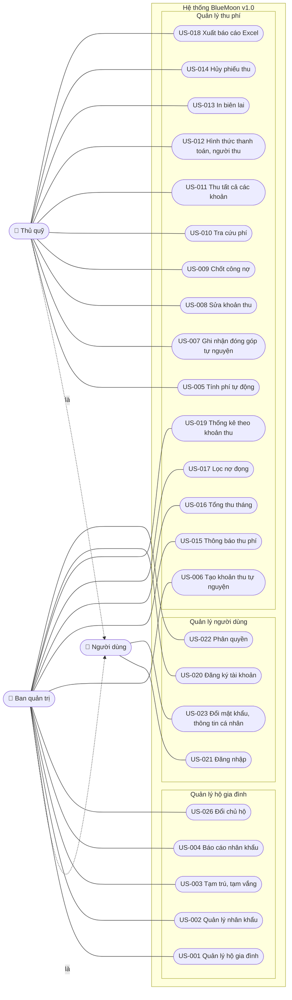

# Sơ đồ use case – BlueMoon v1.0

Lấy từ [07-user-stories.md](../requirements/07-user-stories.md): mỗi use
case là một User Story, tác nhân là vai trò trong câu "Là …, tôi muốn …".
Không gồm US-024, US-025 (v2.0, Won't).

## Tác nhân

| Tác nhân | Vai trò trong hệ thống (tài khoản) | Ghi chú |
|---|---|---|
| Ban quản trị | Quản trị viên (`QUAN_TRI`) | Quản lý cư dân, khoản thu, tài khoản, báo cáo |
| Thủ quỹ | Nhân viên thu phí (`THU_QUY`) | Thu phí, biên lai, công nợ |
| Người dùng | Cả hai vai trò | Đăng nhập, đổi mật khẩu |

Tên vai trò "Thủ quỹ" và "Nhân viên thu phí" đang dùng song song trong tài
liệu yêu cầu; nhóm sẽ chốt một tên trước khi làm US-022.

## Sơ đồ

## Quan hệ include / extend chính

Đề xuất của nhóm dựa trên mô tả story; cần chốt lại khi thiết kế chi tiết
module thu phí (Sprint 2–3).

| Use case | Quan hệ | Use case liên quan | Ý nghĩa |
|---|---|---|---|
| Mọi use case (trừ US-021) | include | US-021 Đăng nhập | Phải đăng nhập trước khi dùng chức năng |
| US-011 Thu tất cả các khoản | include | US-010 Tra cứu phí | Thu phí bắt đầu bằng tra cứu theo mã phòng |
| US-011 Thu tất cả các khoản | include | US-012 Hình thức thanh toán | Mỗi lần thu ghi hình thức và người thu |
| US-013 In biên lai | extend | US-011 Thu tất cả các khoản | In biên lai sau khi thu (tùy chọn) |
| US-014 Hủy phiếu thu | extend | US-011 Thu tất cả các khoản | Chỉ khi thu nhầm, trong ngày |
| US-009 Chốt công nợ | include | US-005 Tính phí tự động | Công nợ đầu tháng dựa trên phí tính theo diện tích |

## Trạng thái theo Sprint

| Module | Đã xong (Sprint 1) | Sprint 2 | Sprint 3 | Sprint 4 |
|---|---|---|---|---|
| Hộ gia đình | US-001, 002, 003 | | US-004 | |
| Thu phí | | US-005, 006, 008, 009 | US-007, 010–015 | US-016–019 |
| Người dùng | US-020, 021 | US-022, 023 | | |
