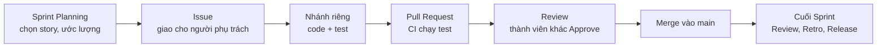

# Quy trình làm việc

Nhóm làm theo Scrum, mỗi Sprint 2 tuần. Tài liệu này mô tả một vòng làm
việc từ lúc nhận việc đến lúc phát hành, để mọi thành viên làm cùng một
cách.

## Tổng quan một Sprint



## 1. Chuẩn bị máy (một lần)

Cài môi trường theo [setup.md](setup.md). Đặt tên và email Git trùng với
tài khoản GitHub của bạn để commit hiển thị đúng người:

```
git config --global user.name "Ho Ten"
git config --global user.email "email-tai-khoan-github@example.com"
```

## 2. Làm một User Story

1. Nhận Issue của story (mỗi story một Issue, có người phụ trách và người
   review).
2. Tạo nhánh từ `main` mới nhất:
   ```
   git checkout main
   git pull
   git checkout -b feature/US-005-tinh-phi-dich-vu
   ```
3. Viết code và test, commit theo từng bước nhỏ.
4. Push nhánh, mở Pull Request vào `main`, ghi `Closes #<số issue>` trong
   mô tả.
5. Người review đọc thay đổi, chạy thử và Approve. CI xanh và có Approve
   thì merge, sau đó xóa nhánh.

Story được tính là xong khi đạt
[Definition of Done](requirements/10-definition-of-done.md).

## 3. Đặt tên nhánh và commit

| Loại việc | Nhánh | Commit mẫu |
|---|---|---|
| Chức năng mới | `feature/US-xxx-ten` | `feat(US-005): tinh phi dich vu theo dien tich` |
| Sửa lỗi | `fix/ten-loi` | `fix(US-002): chan trung CCCD khi hai may cung luu` |
| Test | `test/noi-dung` | `test(US-009): them test chot cong no` |
| Tài liệu | `docs/noi-dung` | `docs: cap nhat ERD bang khoan_phi` |
| Cấu hình, build | `chore/noi-dung` | `chore: them plugin dong goi jar` |

Message nên nói rõ đã làm gì, bắt đầu bằng động từ. Nên sửa file trên máy
rồi commit, thay vì sửa trên giao diện web GitHub.

## 4. Họp và ghi chép

- Sprint Planning đầu Sprint, Sprint Review và Retrospective cuối Sprint.
- Biên bản lưu ở [meeting-notes](meeting-notes): quyết định chính và việc
  của từng người.
- Khi làm cặp hoặc hỗ trợ nhau, ghi tên những người cùng làm trong mô tả
  Pull Request.

## 5. Kết thúc Sprint: phát hành

1. Merge các Pull Request của Sprint, cập nhật trạng thái trong
   [Product Backlog](requirements/08-product-backlog.md).
2. GitHub → Releases → Draft a new release, tạo tag trên `main`:
   Sprint 1 `v0.1.0`, Sprint 2 `v0.2.0`, Sprint 3 `v0.3.0`, Sprint 4 `v1.0.0`.
3. Mô tả gồm story đã xong (kèm AC, Pull Request), kết quả test, hạn chế
   còn lại; đính kèm `database/schema.sql` và `database/seed.sql`.
4. Nâng `<version>` trong `pom.xml` cho Sprint tiếp theo
   (ví dụ `0.2.0-SNAPSHOT` → `0.3.0-SNAPSHOT`).

Lịch sử của `main` giữ nguyên sau khi đã có Release, để mỗi tag luôn trỏ
đúng phiên bản.

## 6. Lưu ý

- Mật khẩu CSDL để trong `config/db.properties` trên máy mình; file này đã
  có trong `.gitignore`.
- Quy ước viết mã: [coding-convention.md](design/coding-convention.md).
